# 🚀 AWS EC2 Infrastructure Observability & Real-Time Alerting with Datadog

A comprehensive, end-to-end cloud infrastructure monitoring and automated alerting solution implemented on an **AWS EC2 Linux instance** using the **Datadog Agent v7**. 

This project demonstrates the full observability and incident response lifecycle: from custom telemetry dashboards and multi-tier alert threshold configuration to synthetic CPU load injection using `stress-ng`, automated multi-channel email notifications, and automated recovery verification.

---

## 📑 Table of Contents
- [Architecture Overview](#-architecture-overview)
- [Target Environment & Infrastructure Specs](#-target-environment--infrastructure-specs)
- [Project Highlights](#-project-highlights)
- [Step-by-Step Implementation](#-step-by-step-implementation)
  - [1. Host Provisioning & Connect](#1-host-provisioning--connect)
  - [2. Datadog Agent v7 Installation](#2-datadog-agent-v7-installation)
  - [3. Custom Dashboard Design (`EC2 Infrastructure Monitoring`)](#3-custom-dashboard-design-ec2-infrastructure-monitoring)
  - [4. Multi-Tier Alert Monitor Configuration (`EC2 - High CPU Usage`)](#4-multi-tier-alert-monitor-configuration-ec2---high-cpu-usage)
  - [5. Stress Testing & Anomaly Simulation (`stress-ng`)](#5-stress-testing--anomaly-simulation-stress-ng)
  - [6. Incident Lifecycle & Telemetry Response](#6-incident-lifecycle--telemetry-response)
  - [7. Automated Email Alerting & Notification Pipeline](#7-automated-email-alerting--notification-pipeline)
- [Incident Progression & Timeline Audit](#-incident-progression--timeline-audit)
- [Troubleshooting & Key Learnings](#-troubleshooting--key-learnings)
- [Repository Structure](#-repository-structure)

---

## 🏛 Architecture Overview

<p align="center">
  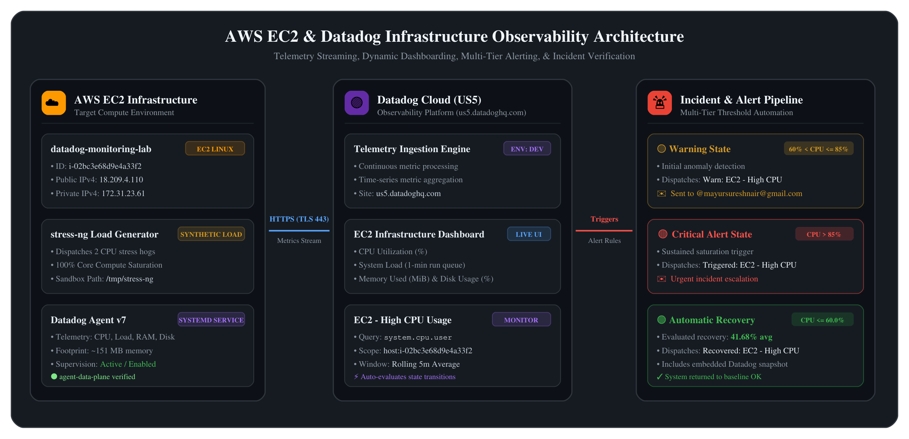
</p>

---

## 🖥 Target Environment & Infrastructure Specs

| Parameter | Value |
| :--- | :--- |
| **Instance Name** | `datadog-monitoring-lab` |
| **Instance ID** | `i-02bc3e68d9e4a33f2` |
| **Public IPv4** | `18.209.4.110` |
| **Private IPv4** | `172.31.23.61` |
| **Private DNS** | `ip-172-31-23-61.ec2.internal` |
| **Access Method** | AWS Systems Manager (SSM) / EC2 Instance Connect |
| **Datadog Site** | `us5.datadoghq.com` (US5 Region) |
| **Environment Tag** | `dev` (`DD_ENV=dev`) |
| **Datadog Agent** | Agent 7 (`datadog-agent.service` via `systemd`) |
| **Notification Channel** | Email (`@mayursureshnair@gmail.com`) |

---

## 🌟 Project Highlights

- **Lightweight System Integration:** Deployed the official Datadog Agent v7 daemon with process isolation and managed systemd service supervision.
- **Unified Observability Dashboard:** Built an intuitive dashboard displaying correlated real-time infrastructure widgets (CPU Utilization, System Load, Memory Usage, Disk Usage).
- **Automated Dual-Threshold Alerting:** Configured a metric-based monitor featuring warning levels (`60%`) and critical alert levels (`85%`).
- **End-to-End Notification Dispatch:** Integrated automated email alerts notifying stakeholders across all states: `Warn`, `Triggered (Alert)`, and `Recovered`.
- **Simulated Real-World Load Incident:** Used `stress-ng` with custom temporary execution flags to stress 2 CPU cores, testing monitor responsiveness and telemetry granularity.
- **Full-Cycle Incident Validation:** Successfully captured the complete transition: `OK` ➡️ `WARN` ➡️ `ALERT` ➡️ `Mitigation (SIGINT)` ➡️ `OK (Cooldown)` with verified metric graph snapshots in alert emails.

---

## 🛠 Step-by-Step Implementation

### 1. Host Provisioning & Connect
The target machine `datadog-monitoring-lab` was provisioned in AWS EC2 and accessed securely using AWS Systems Manager / EC2 Instance Connect.

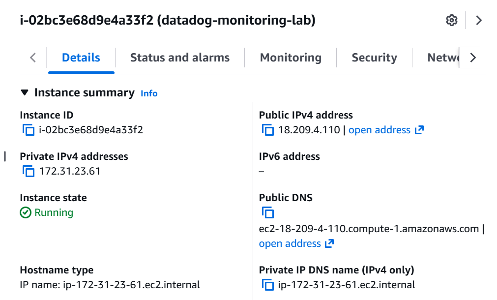

---

### 2. Datadog Agent v7 Installation

The Datadog Agent was installed using the official non-interactive installation script configured with the US5 site endpoint and `dev` environment tag:

```bash
DD_API_KEY="<YOUR_DATADOG_API_KEY>" \
DD_SITE="us5.datadoghq.com" \
DD_ENV=dev \
bash -c "$(curl -L https://install.datadoghq.com/scripts/install_script_agent7.sh)"
```

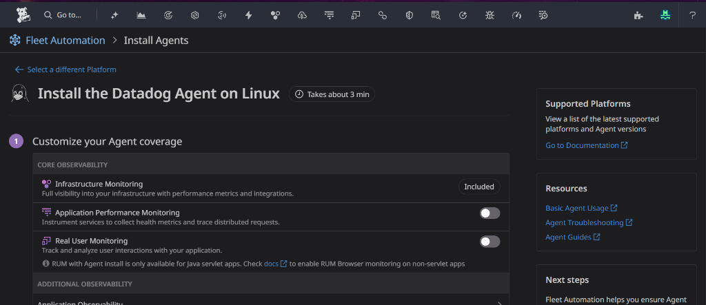

#### Service Verification & Status Check
Verified that the service was properly enabled and running via `systemctl`:

```bash
sudo systemctl status datadog-agent
```

The service status was verified to be actively running with the agent daemon and data-plane processes under systemd supervision:

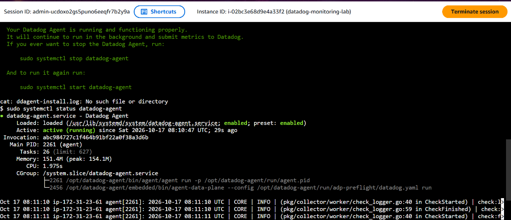

---

### 3. Custom Dashboard Design (`EC2 Infrastructure Monitoring`)

Created a custom dashboard tailored for single-pane-of-glass EC2 infrastructure monitoring:

| Widget Name | Telemetry Metric | Purpose |
| :--- | :--- | :--- |
| **CPU Utilization** | `system.cpu.user`, `system.cpu.system` | Tracks total percentage of compute consumed. |
| **System Load** | `system.load.1`, `system.load.norm.1` | Displays average CPU run queue load over 1 minute. |
| **Memory Used** | `system.mem.used` (Mebibytes) | Monitors memory allocation and active consumption. |
| **Disk Usage** | `system.disk.used` / `system.disk.in_use` | Ensures filesystem storage stays within safety limits. |

#### Baseline State (Idle System)
Before injecting any load, the system maintained an idle baseline (~0.6–1.3% CPU utilization, ~830 MiB memory, ~38% disk usage).

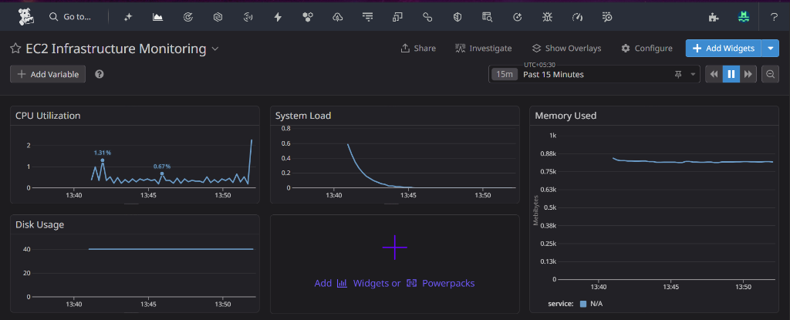

---

### 4. Multi-Tier Alert Monitor Configuration (`EC2 - High CPU Usage`)

Created a metric monitor in Datadog to proactively detect compute starvation and alert operators before service degradation occurs:

- **Monitor Name:** `EC2 - High CPU Usage`
- **Metric Query:**
  ```text
  avg(last_5m):avg:system.cpu.user{host:i-02bc3e68d9e4a33f2} > 85
  ```
- **Evaluation Window:** Average over the last 5 minutes
- **Threshold Rules:**
  - 🟡 **Warning Threshold:** `60% < y <= 85%`
  - 🔴 **Alert / Critical Threshold:** `y > 85%`
  - 🟢 **Recovery Threshold:** `<= 60.0%`
- **Notification Target:** `@mayursureshnair@gmail.com`

#### Initial Monitor State: OK
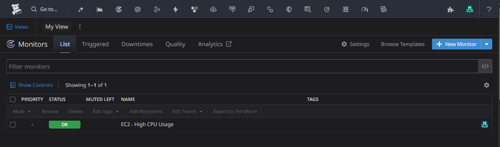

---

### 5. Stress Testing & Anomaly Simulation (`stress-ng`)

To rigorously test our monitoring and alerting pipeline, we simulated synthetic CPU starvation on the EC2 instance using `stress-ng`.

#### Installation:
```bash
sudo apt-get update
sudo apt-get install -y stress-ng
```

#### Executing Load Generation:
*(Note: If permission restrictions affect `/tmp`, specify an explicit sandbox path):*

```bash
mkdir -p /tmp/stress-ng
chmod 700 /tmp/stress-ng

# Stress 2 CPU stressors for up to 600s
stress-ng --temp-path /tmp/stress-ng --cpu 2 --timeout 600s
```

The tool immediately dispatched 2 CPU hogs to saturate the instance's available processing cores.

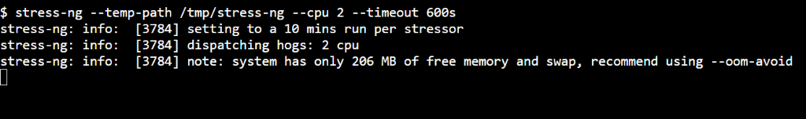

---

### 6. Incident Lifecycle & Telemetry Response

#### Stage 1: CPU Saturation & Dashboard Spike
Within seconds of launching `stress-ng`, the dashboard reflected the immediate workload shift:
- **CPU Utilization:** Surged from ~1% directly to **~95–100%**.
- **System Load:** Climbed steadily past **2.0**.
- **Memory Consumption:** Adjusted dynamically around 640–720 MiB.

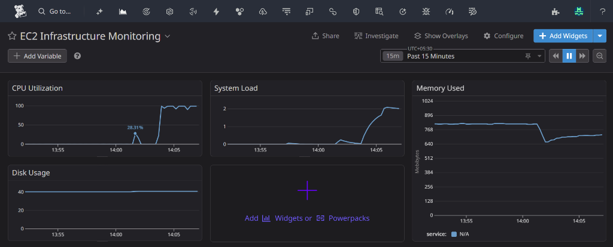

#### Stage 2: Warning Threshold Breach (`WARN`)
As the evaluated metric crossed 60% at 14:06 UTC, the monitor automatically transitioned from `OK` to **`WARN`**:

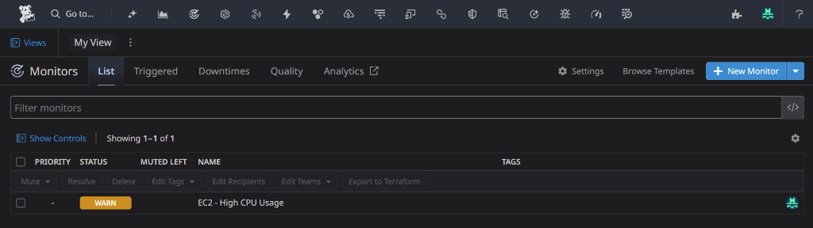
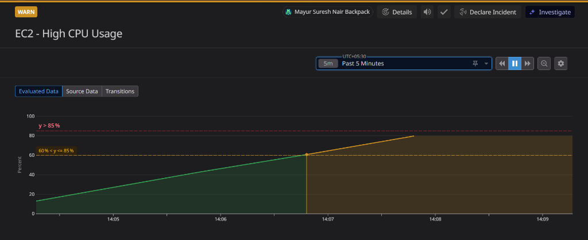

#### Stage 3: Critical Threshold Breach (`ALERT`)
As sustained load surpassed the 85% threshold at 14:08 UTC, the monitor escalated to **`ALERT`** status:

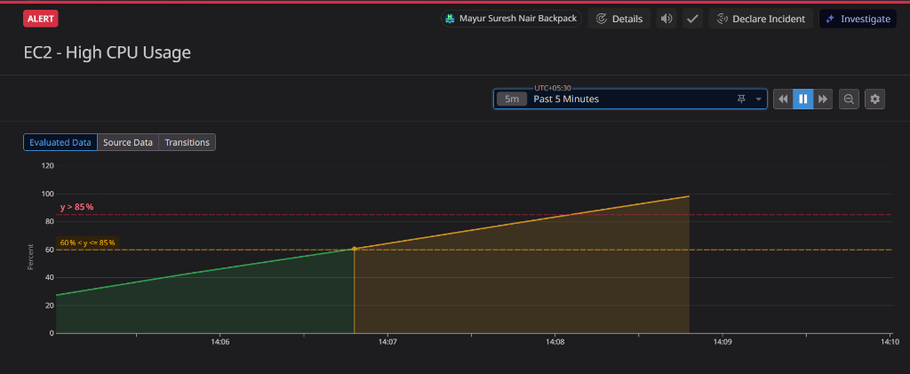

#### Stage 4: Incident Mitigation (Stopping Stressors)
The simulated incident was resolved by terminating the `stress-ng` process using `Ctrl + C` after a 7-minute sustained stress run:

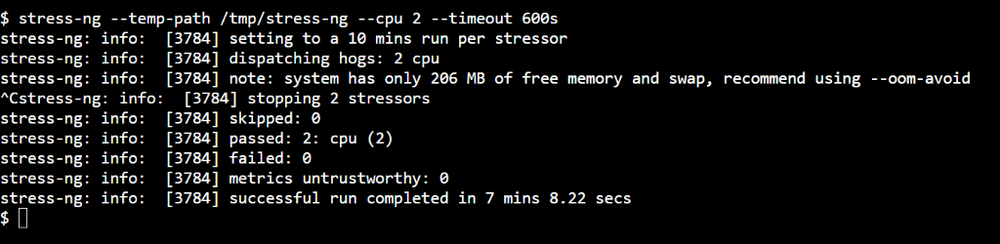

#### Stage 5: Telemetry Cooldown & Automatic Recovery
Immediately upon process termination:
1. The **EC2 Infrastructure Monitoring** dashboard showed CPU dropping precipitously back to ~0–1%, and system load normalizing.
2. The Datadog monitor evaluated the descending metric, transitioning smoothly from `ALERT` ➡️ `WARN` ➡️ **`OK`**.

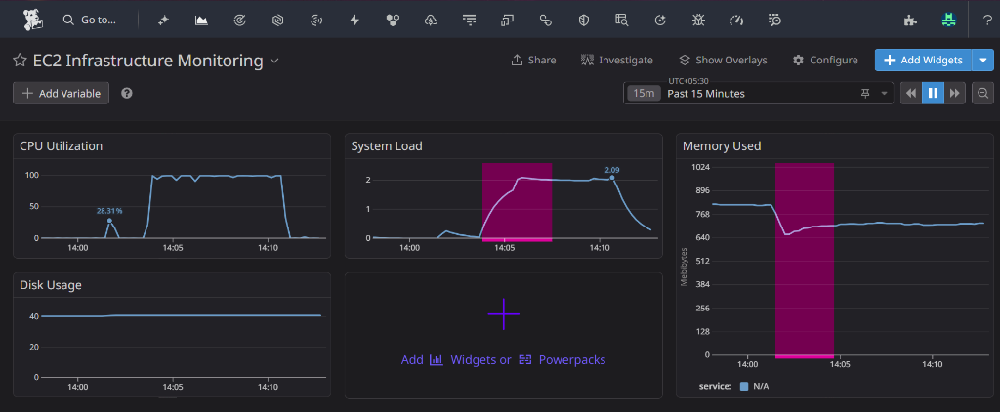
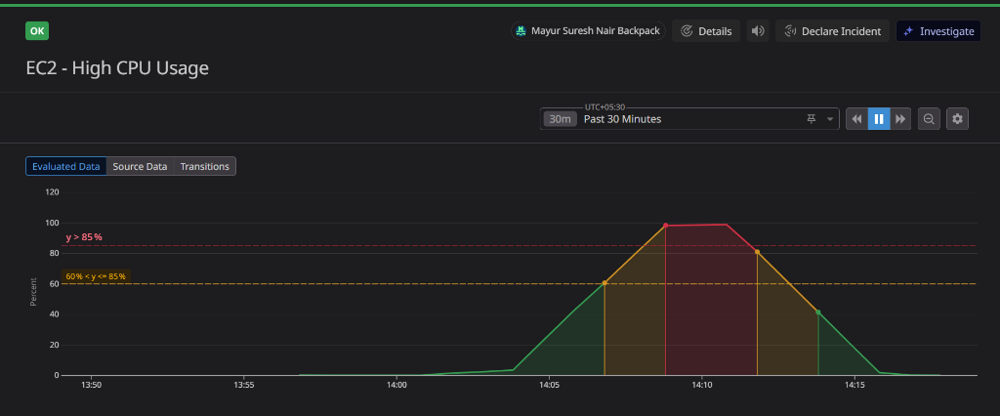

---

### 7. Automated Email Alerting & Notification Pipeline

The Datadog alerting engine automatically dispatched rich email notifications to `@mayursureshnair@gmail.com` at every phase of the incident:

1. **`Warn: EC2 - High CPU Usage`**: Triggered when rolling 5m CPU crossed 60%.
2. **`Triggered: EC2 - High CPU Usage`**: Triggered when rolling 5m CPU breached critical threshold (>85%).
3. **`Recovered: EC2 - High CPU Usage`**: Dispatched when CPU returned and stabilized below 60%.

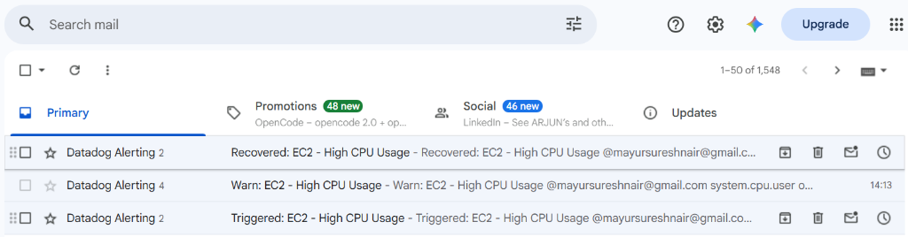

#### Detailed Recovery Email Analysis
The automated recovery notification included a rendered snapshot of the metric's trajectory:
- **Condition Evaluated:** `system.cpu.user over host:i-02bc3e68d9e4a33f2 was <= 60.0 on average during the last 5m.`
- **Evaluated Value:** Dropped from a sustained peak of **99.9%** down to a rolling 5-minute average of **41.68%**, successfully satisfying the recovery criteria.

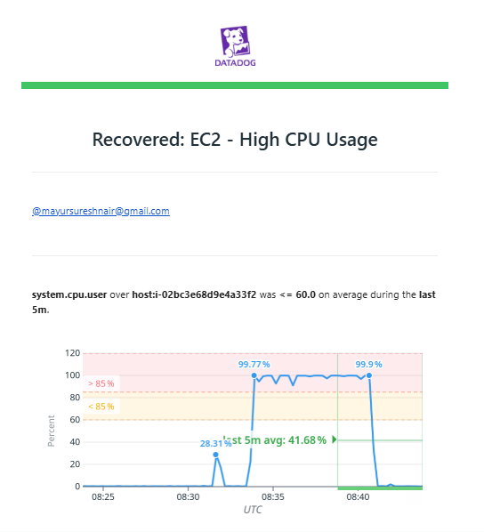

---

## 📊 Incident Progression & Timeline Audit

| Timestamp (Approx) | Metric Value (`system.cpu.user`) | Trigger / Operational Action | Monitor State | Email Notification Dispatched |
| :---: | :---: | :---: | :---: | :---: |
| **14:00 - 14:04** | `< 2%` CPU | Baseline Idle Workload | 🟢 **OK** | — |
| **14:04** | `~95%` CPU | `stress-ng --cpu 2` launched | 🟢 **OK** (Evaluating) | — |
| **14:06** | `> 60%` CPU | Warning Threshold Crossed | 🟡 **WARN** | ✉️ `Warn: EC2 - High CPU Usage` |
| **14:08** | `> 85%` CPU | Critical Alert Threshold Crossed | 🔴 **ALERT** | ✉️ `Triggered: EC2 - High CPU Usage` |
| **14:11** | `~0%` CPU | `Ctrl + C` sent / stress-ng halted | 🔴 **ALERT** (Decaying) | — |
| **14:12** | `< 85%` CPU | Recovery Trajectory in progress | 🟡 **WARN** | — |
| **14:14** | `<= 60%` (41.68% avg) | Full System Normalization Verified | 🟢 **OK** | ✉️ `Recovered: EC2 - High CPU Usage` |

---

## 💡 Troubleshooting & Key Learnings

1. **`stress-ng` Temporary Directory Permissions:**  
   On locked-down cloud instances or restricted user environments, `stress-ng` may fail if the default temporary directory has restricted write/execute permissions. Providing `--temp-path /tmp/stress-ng` with `chmod 700` guarantees reliable testing without permissions denial.

2. **Memory Headroom & OOM Avoidance:**  
   During stress testing on micro/small EC2 instances with tight RAM (~1 GB total), running CPU stressors alongside agent processes can trigger kernel OOM kills. Observing the agent's peak memory (~154 MB) ensures optimal sizing.

3. **Evaluation Window Responsiveness:**  
   Selecting a `5-minute` rolling average window balances alert sensitivity against transient burst spikes, preventing false positive alerts while ensuring genuine sustained bottlenecks are captured within 2–3 minutes.

4. **Hysteresis & Recovery Thresholding:**  
   By establishing an explicit recovery threshold (`<= 60.0%`), Datadog prevents "alert flapping" (rapid oscillating between Alert and OK states) during intermittent workload fluctuations.

---

## 📂 Repository Structure

```text
datadog-ec2-monitoring/
├── README.md                               # Complete project documentation & walkthrough
└── screenshots/                            # Visual evidence & architecture captures
    ├── architecture-diagram.png            # High-resolution system architecture diagram
    ├── 01-ec2-instance-details.png         # AWS EC2 Management Console details
    ├── 02-datadog-agent-setup.png          # Datadog Agent installation guide UI
    ├── 03-agent-service-running.png        # systemctl agent active status verification
    ├── 04-dashboard-baseline-idle.png      # Idle system dashboard state
    ├── 05-monitor-ok-state.png             # Initial monitor list state (OK)
    ├── 06-stress-testing-initiated.png     # stress-ng command execution in terminal
    ├── 07-dashboard-under-load.png         # Telemetry spike under 100% CPU stress
    ├── 08-monitor-warn-state.png           # Monitor list indicating WARN state
    ├── 09-monitor-eval-warn-threshold.png  # Threshold evaluation line graph (WARN)
    ├── 10-monitor-eval-alert-threshold.png # Threshold evaluation line graph (ALERT)
    ├── 11-stress-completed-interrupted.png # Process mitigation & SIGINT summary
    ├── 12-dashboard-recovery.png           # Cooldown graph showing metrics returning to 0%
    ├── 13-monitor-full-incident-lifecycle.png # Bell-curve lifecycle graph (OK -> WARN -> ALERT -> OK)
    ├── 14-email-notifications-inbox.png    # Gmail inbox with Triggered, Warn, and Recovered alerts
    └── 15-datadog-recovery-email-detail.png # Detailed Datadog recovery email with graph & formula
```

---

## 👤 Author
Developed and verified by **Mayur Suresh Nair**  
*Observability & Cloud Infrastructure Monitoring with Datadog and AWS*
